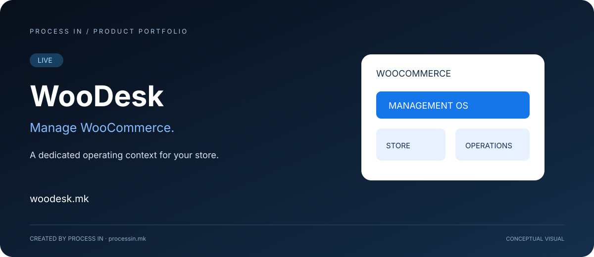

# WooDesk

**WooCommerce yönetimi için bir işletim sistemi.**

[Македонски](README.mk.md) · [English](README.md) · [Shqip](README.sq.md) · [Türkçe](README.tr.md)

**LIVE**

## Sorun ve çözüm

WooDesk, WooCommerce yönetimi için geliştirilmiş PROCESS IN işletim sistemidir. Amacı, WooCommerce yönetimine özel bir çalışma bağlamı sağlayarak işletmenin çevrim içi mağazasını sürekli bir operasyon olarak ele almasına yardımcı olmaktır.

Mağaza işletmek, bir web sitesi sunmaktan fazlasını gerektirir. Sorumlu kişilerin mağazayla ilgili yönetim işlerini düzenlemek için net bir yaklaşıma ihtiyacı vardır. WooDesk bu operasyonel ihtiyaca odaklanır: WooCommerce'i işletmenin günlük çalışmalarının bir parçası olarak yönetmek.

## Nasıl başlanır

Ürünü değerlendirmek ve kullanıma sunmak için önerilen yaklaşım:

| Adım | İşlem |
|---|---|
| 01 | Resmî siteyi ziyaret edip WooCommerce yönetim ihtiyaçlarınızı açıklayın. |
| 02 | Mağazayı kimin yönettiğini ve en önemli günlük görevleri belirleyin. |
| 03 | WooDesk'in güncel desteklenen kapsamını PROCESS IN ile inceleyin. |
| 04 | Mağazanızın gerçek gereksinimlerine uygun yönetim yaklaşımını seçin. |

## Ürünün kapsamı

| Alan | Amaç |
|---|---|
| **WooCommerce odağı** | WooCommerce yönetimi etrafında şekillenen bir ürün. |
| **Operasyonel amaç** | Mağazadan sorumlu kişilere özel bir işletim sistemi yaklaşımı. |
| **İşletme yönetimi bağlamı** | Mağaza idaresini sürekli iş operasyonu olarak ele alma; desteklenen gerçek kapsam ürün değerlendirmesinde doğrulanır. |

## Kimler için

WooCommerce mağaza sahipleri, mağaza yöneticileri ve e-ticaret operasyon ekipleri için. Müşterilerinin WooCommerce işletmesine operasyonel çözüm arayan ajanslar için de uygundur.

## Kullanım senaryosu

Bir WooCommerce işletmesi mağaza yönetimine daha net bir yaklaşım ister. İşletme sahibi WooDesk değerlendirmesiyle yönetim sorumluluklarını belirleyebilir, bunları ürünün desteklenen kapsamıyla karşılaştırabilir ve işletim sistemi yaklaşımının işletmeye uyup uymadığına karar verebilir.

## Neden değerlendirilmeli

WooDesk görüşmeye somut bir odak kazandırır: WooCommerce yönetimi. Alıcı böylece genel bir iş uygulamasıyla mağazanın özel ihtiyaçlarını karşılaştırmak yerine operasyonel uyumu değerlendirebilir. Asıl konu, desteklenen kapsamın işletmenin gerçekten yaptığı işlerle ne kadar örtüştüğüdür.

## Ekiple görüşülecek konular

Mağaza kurulumunu, yönetim sorumluluklarını ve gerekli iş akışlarını PROCESS IN ile görüşün. Ürün sahibi WooDesk'in amacını doğrulamıştır; belirli modüller, bağlayıcılar, desteklenen eklentiler ve senkronizasyon davranışları burada listelenmez. Belirli bir iş akışına güvenmeden önce bunları mağazanız için doğrulayın.

## Ürün deneyimi

Ana görsel ürünün amacını kavramsal olarak anlatır. Güncel arayüzü ve teklifi resmî ürün üzerinden inceleyin.

## Ürün bilgileri

| Ayrıntı | Değer |
|---|---|
| Web sitesi | [woodesk.mk](https://woodesk.mk) |
| Kategori | WooCommerce yönetim işletim sistemi |
| Durum | LIVE |
| Geliştirici | [PROCESS IN](https://processin.mk) |
| Portföy | [PROCESS IN GitHub](https://github.com/stambolce/process-in) |

### [WooDesk'i ziyaret edin](https://woodesk.mk)

Herkese açık ürün sunumu. Özel uygulama kodu veya müşteri verisi içermez.

---

This platform is a digital product of <a href="https://processin.mk" target="_blank" >PROCESS IN </a>· Your Enterprise Software & AI Partner ·  Hosted on Enterprise Infrastructure by <a href="https://inhost.mk" target="_blank">INHOST</a>·
